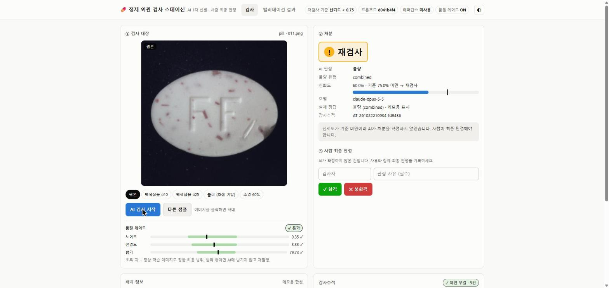
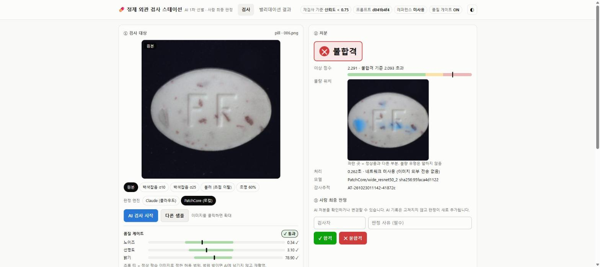
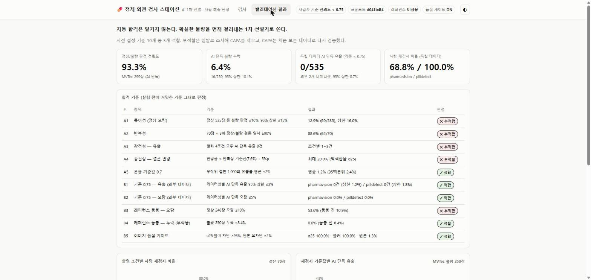
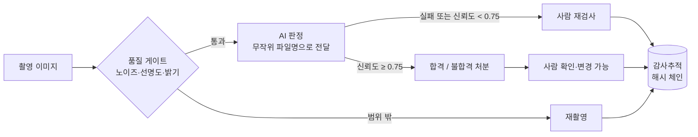

# AI 정제 외관 검사기 (AI Tablet Visual Inspector)

정제·캡슐 외관검사에서 범용 비전 AI(Claude)에게 **어디까지 맡겨도 되는지**를 제약 QC의 **시험법 밸리데이션 방식**으로 검증한 프로젝트.
합격 기준을 실험 전에 커밋하고, 부적합은 일탈로 조사하고, 시정 조치(CAPA)는 처음 보는 데이터로 다시 검증했다.
v5에서는 공장에서 쓸 수 있도록 **이미지가 PC 밖으로 나가지 않는 로컬 고정 모델(PatchCore)** 로 판정을 옮겨 같은 기준으로 비교했다.



## 결론

> **AI에게 "자동 합격"은 맡기지 않는다. 확실한 불량을 먼저 걸러내는 1차 선별기로 쓰고, 최종 판정은 사람이 한다.**

- AI 단독으로는 불량의 **6.4%를 놓친다** (MVTec 250장 중 16장). 그대로는 쓸 수 없다.
- 놓친 불량은 전부 신뢰도가 낮았다(유출 14건이 전부 신뢰도 0.7). 그래서 **신뢰도 0.75 미만은 사람 재검사**로 넘기는 규칙을 만들었다.
  처음 보는 외부 데이터 995장에서 **AI가 혼자 합격시킨 불량 0/535건** (95% 상한 0.7%), AI 단독 오탐 0/460건.
  단, 이 외부 데이터에서는 기존 0.7 규칙도 유출이 0이었다. 0.75는 "안전하다"는 확인이지 "더 낫다"는 증명은 아니다.
- 대가는 재검사 부담이다: 68.8~100%. 모델은 "정상"을 자신 있게 말하지 못하고, 신뢰도는 제품마다 다르게 어긋나 있다.
- 노이즈·블러·저조도 이미지는 **품질 게이트가 판정 전에 100% 걸러** 재촬영으로 보낸다.
- **v5 로컬 고정 모델**: 같은 홀드아웃 135장에서 유출 0건, 장당 0.35초(CPU, Claude 7.7초), 3회 반복 점수 100% 동일,
  네트워크를 끊은 상태로 전체 검사 완료. 재검사 비율은 44.4%(Claude 64.4%)로 낮췄지만 기준 30%는 넘었고,
  정상품을 자동 합격시킨 건 20장 중 3장뿐이라 실제 라인 부담은 여전히 크다 (일탈 D8).

- **v6 (D8 CAPA)**: 사람 부담을 "정상품 자동 합격률"로 다시 정의하고 평가 정상품을 118장으로 늘렸다. 유출 0은 유지,
  정상품 자동 합격은 22.0%(Claude 2.5%)로 기준 50% 미달. 제품별로는 **capsule 47%, pill 1.5%** 로 갈렸다 (일탈 D9).
  결론: capsule은 일부 자동 합격이 가능해 보이고, pill은 미세 균열과 정상 표면을 구분하지 못해 불량 선별 전용으로만 쓸 수 있다.
- **v7 (D9 CAPA)**: "해상도가 낮아서"라는 가설을 448px로 검증 → **기각** (pill 0%, 병목이 균열에서 변색으로 이동).
  대신 capsule은 47% → **92.5%**. 하지만 사전 채택 규칙이 "pill 개선"이라 v7은 채택하지 않았다 (일탈 D10, v8에서 새 데이터로 재검증 예정).
  제품별 운용 정책은 적용했다: **capsule 자동 합격 허용, pill 불량 선별 전용**.
- **정제가 안 되는 근본 원인**: 가장 약한 불량이 정상 정제에 원래 있는 빨간 반점과 똑같이 생긴 점 하나였다 (정답 마스크로 확인).
  모델보다 **외관 규격(한도견본·결함 등급) 정의의 문제**다. 다음 단계는 결함을 치명·중·경결함으로 나눠 등급별 기준을 적용하는 것.

  

- 효과가 있어 보였던 개선안(정상품 레퍼런스 동봉)은 검증해 보니 **정상 오탐을 10.9% → 53.6%로 악화**시켜 채택하지 않았다.

## 밸리데이션 결과 — 사전 설정 기준 28개

| # | 항목 | 결과 | 판정 |
|---|---|---|---|
| A1 | 특이성: 정상 535장 오탐 ≤10% | 12.9% | ❌ |
| A2 | 반복성: 70장 × 3회 결론 일치 ≥90% | 88.6% (불일치 8장은 모두 신뢰도 ≤0.7 → 현재 기준에선 재검사 구간) | ❌ |
| A3 | 강건성: 열화 4조건 유출 0건 | 1~3건 (전부 신뢰도 0.7 경계값) | ❌ |
| A4 | 강건성: 결론 변경률 ≤ 기준선 + 5%p | 백색잡음 σ25에서 20% | ❌ |
| A5 | 기준값 0.7: 무작위 절반 유출률 ≤2% | 1.2% | ✅ |
| B1 | **기준 0.75: 외부 데이터 유출 상한 ≤3%** | 0건 (상한 1.2%, 1.8%). 0.7에서도 0건 | ✅ → 적용 |
| B2 | 기준 0.75: 외부 데이터 AI 단독 오탐 ≤5% | 0% | ✅ → 적용 |
| B3 | 레퍼런스 동봉: 정상 오탐 ≤10% | 53.6% (악화) | ❌ → 미채택 |
| B4 | 레퍼런스 동봉: 누락 ≤8.4% | 0% | ✅ |
| B5 | **품질 게이트: 열화 차단 ≥95%, 원본 오차단 ≤2%** | 100% / 1.3% | ✅ → 적용 |
| C1 | 로컬 모델: 홀드아웃 유출 0건 | 0/115 (95% 상한 3.2%) | ✅ |
| C2 | 로컬 모델: 재검사 비율 ≤30% | 44.4% (Claude 64.4%) | ❌ → 일탈 D8 |
| C3 | 로컬 모델: 단독 오탐 ≤5% | 1/20 = 5.0% (경계) | ✅ |
| C4 | 로컬 모델: 장당 ≤1초 | 0.35초 (CPU) | ✅ |
| C5 | 로컬 모델: 3회 점수 비트 단위 동일 | 299장 모두 동일 | ✅ |
| C6 | 네트워크 차단 상태로 전체 검사 | 2회 완료 | ✅ |
| F1 | v6 로컬: 평가 불량 유출 0건 | 0/115 | ✅ |
| F2 | **v6 로컬: 정상품 자동 합격 ≥50%** | 22.0% (capsule 47%, pill 1.5%) | ❌ → 일탈 D9 |
| F3 | v6 로컬: 정상 단독 불합격 ≤2% | 0.8% (1/118) | ✅ |
| F4 | v6 로컬: 장당 ≤1초 | 0.25초 | ✅ |
| F5 | v6 로컬: 3회 점수 비트 단위 동일 | 500장 모두 동일 | ✅ |
| F6 | v6 네트워크 차단 상태로 전체 검사 | 2회 완료 | ✅ → 로컬 엔진 v6로 교체 |
| G1 | v7 448px: 유출 0건 | 0/115 | ✅ |
| G2 | **v7: pill 정상품 자동 합격 ≥20% (해상도 가설)** | 0.0% | ❌ 가설 기각 |
| G3 | v7: 정상품 자동 합격 ≥50% | 41.5% (capsule 92.5%) | ❌ |
| G4 | v7: 정상 단독 불합격 ≤2% | 1.7% | ✅ |
| G5 | v7: 장당 ≤1초 | 0.54초 | ✅ |
| G6 | v7: 3회 동일·망분리 | 충족 | ✅ → 채택 규칙 미충족, v6 유지 (D10) |

A는 v3([기준](PROJECT_PLAN.md#4-합격-기준-사전-설정-v3-실험-전), 커밋 `1c9d2ac`), B는 v4([기준](PROJECT_PLAN.md#7-v4-프로토콜--capa-검증-사전-설정-v4-실험-전), 커밋 `5e03cf7`),
C는 v5([기준](PROJECT_PLAN.md#8-v5-프로토콜--온프레미스-검사-사전-설정-v5-실험-전), 커밋 `45b6f03`),
F는 v6([기준](PROJECT_PLAN.md#9-v6-프로토콜--d8-capa-재검사-부담을-실제-라인-기준으로-사전-설정-v6-실험-전), 커밋 `b0eced7`),
G는 v7([기준](PROJECT_PLAN.md#10-v7-프로토콜--d9-capa-해상도-가설-검증과-제품별-운용-정책-사전-설정-v7-실험-전), 커밋 `0304723`)이다.
C2 부적합으로 로컬 모델은 기본 엔진이 아니라 데모에서 고를 수 있는 시험 엔진으로만 넣었다 (프로토콜에 미리 정한 조치).
일탈 D1~D10과 CAPA는 [EVALUATION_REPORT.md](EVALUATION_REPORT.md)에 있다.



## 진행 이력 — 결과가 아니라 측정을 의심한 기록

| 단계 | 한 일 | 배운 것 |
|---|---|---|
| v1 | 79장 벤치마크: 정확도 97.5%, 누락 0% | **철회.** 이미지 경로(`.../test/crack/003.png`)에 정답이 들어 있었다. 같은 이미지를 다시 재니 63.3%, 누락 8건 |
| v2 | 누출 차단, 299장 전수 측정, 판정 실패도 분모에 포함 | AI 단독 누락 6.4%. 누락은 전부 저신뢰 |
| v3 | 밸리데이션 프로토콜, 반복성·강건성(백색잡음·블러·저조도)·특이성 | 기준 4/5 부적합. 유출 14건이 **전부 신뢰도 0.7 경계값** |
| v4 | CAPA 3개를 독립 데이터로 검증 | 2개 적용, 1개 기각. **판정 실패 93%가 "적합"으로 집계되던 분석 결함(D7)** 을 찾아 무효 판정 규칙 추가 |
| v5 | 기밀 유지용 로컬 고정 모델(PatchCore), 기준값 선정 절차까지 홀드아웃 | 6개 중 5개 적합. 속도 22배·재현성 100%·망분리. **재검사 기준을 불량 위주 데이터로 잡으면 실제 라인 부담을 과소평가한다(D8)** |
| v6 | 사람 부담 = 정상품 자동 합격률로 재정의, 평가 정상 118장, greedy coreset | 6개 중 5개 적합. 자동 합격 15% → 22%. **평균으론 "조금 부족", 제품별로는 capsule 47% · pill 1.5% (D9)** |
| v7 | 해상도 가설(448px) 검증, 제품별 운용 정책 | 가설 기각. capsule 92.5%로 좋아졌지만 **사전 채택 규칙 때문에 채택 안 함 — 사후에 규칙을 바꾸지 않고 v8 변경관리로 (D10)** |

## 시스템 흐름



## GMP 관점 설계

| 원칙 | 구현 |
|---|---|
| Fail-safe | 판정 실패·저신뢰·품질 미달은 절대 합격 처리하지 않음. 실패도 분모에서 빼지 않음 |
| 사전 설정 기준 | 기준과 적합 시 조치를 실험 전에 커밋 → 결과를 보고 기준을 바꾸지 않았다는 증거가 git 이력에 남음 |
| 통계적 보고 | 0건이어도 "0%"가 아니라 95% 신뢰구간 상한(Wilson)으로 보고. 표본 수는 목표 정밀도에서 역산 |
| 변경관리 | 운용 설정(`REVIEW_THRESHOLD`, `USE_REFERENCE`)은 승인된 값만, 변경 이력을 코드에 기록. 프롬프트는 해시로 버전 관리 |
| 데이터 완전성 (ALCOA+) | 판정마다 시각·판정자·모델 ID·프롬프트 버전·이미지 SHA-256·원출력·처분을 남기고, 해시 체인으로 변조 탐지. 사람 판정은 AI 기록을 고치지 않고 덧붙임 |
| 측정 무결성 | 정답 누출 방지(무작위 파일명), 판정 실패율 >2% 실험은 자동 무효, 재시험은 원본 보존 |

## 실행

```bash
pip install -r requirements.txt   # torch는 CPU판이면 충분: --index-url https://download.pytorch.org/whl/cpu
python -c "import kagglehub; kagglehub.dataset_download('ipythonx/mvtec-ad')"   # MVTec AD 약 5.2GB

python demo_app.py          # 검사 스테이션 데모 → http://127.0.0.1:8931
python test_offline.py      # 데이터·AI 호출 없이 전체 로직 자체검증
python patchcore.py         # v6 로컬 모델 채점 (CPU, 이미지 외부 전송 없음) → results/v6_run1.json
python patchcore.py --offline --out results/v6_run2.json   # 네트워크 차단 상태로 재실행 (재현성·망분리 확인)
python patchcore.py --protocol v5 --method random --out results/v5_run1.json   # v5 재현
python patchcore.py --res 448 --keep 0.01 --out results/v7_run1.json          # v7 고해상도
python analyze.py > results/analysis.md   # 결과 → 판정표 + 대시보드 데이터
```

벤치마크 (Claude Code 구독 인증 필요: `claude auth login`. `ANTHROPIC_API_KEY`는 자동 제외해 과금 방지):

```bash
python benchmark.py --per-type 1000 --workers 3 --out results/run.json        # MVTec 전수
python benchmark.py --per-type 5 --perturb noise25 --workers 3 --out ...       # 강건성: noise10/noise25/blur2/dark60
python benchmark.py --per-type 1000 --splits train --workers 3 --out ...       # 특이성: MVTec 정상 486장
python benchmark.py --dataset pharmavision --per-type 10000 --workers 3 --out ...  # 외부 독립 검증 (pilldefect도 가능)
python benchmark.py ... --out results/run.json --resume                        # 판정 실패 건만 재시험
python quality_gate.py      # 품질 게이트 허용 범위 보정 (train 정상만 사용)
```

## 파일

| 파일 | 내용 |
|---|---|
| `benchmark.py` | 벤치마크 하네스 (누출 방지, 열화, 외부 데이터, 레퍼런스, 재시험) |
| `quality_gate.py` | 이미지 품질 게이트 (보정·판정·평가) |
| `patchcore.py` | 로컬 고정 모델: 정상품 패치 기억(v6 greedy coreset) + 최근접 거리 점수, 히트맵, 네트워크 차단 모드 |
| `analyze.py` | 기준 A1~G6 판정, 로컬 모델 채택·제품별 정책 결정(`local_decision`, 데모가 그대로 사용), 실험 유효성(판정 실패율) 검사, 대시보드 데이터 생성 |
| `demo_app.py`, `templates/index.html` | 검사 스테이션 + 밸리데이션 대시보드 |
| `test_offline.py` | 누출 방지·채점·열화 재현성·게이트·재시험·데모·해시 체인 변조 탐지 자체검증 |
| `PROJECT_PLAN.md` | 밸리데이션 프로토콜 (사용 범위, ICH Q9 위험평가, 기준 A·B) |
| `EVALUATION_REPORT.md` | 결과, 일탈 D1~D10, CAPA |
| `INTERVIEW.md` | 면접 준비 노트 |
| `results/` | 모든 원자료 (v1 철회본 포함), `analysis.md`, `summary.json`, `quality_gate_limits.json` |

## 한계

- 실제 제약사 라인 데이터가 아니다 (공개 연구용 데이터셋).
- 범용 LLM 1종과 로컬 이상탐지 1종(PatchCore, 224 해상도, AUROC pill 0.942 · capsule 0.974)만 측정했다. pill의 미세 균열은 정상과 구분하지 못한다(D9). 로컬 모델은 불량 위치만 보여 주고 유형은 말하지 않는다.
- v5 홀드아웃은 135장(정상 20장)이라 0건이어도 95% 상한이 3%대다.
- 모델 신뢰도는 보정되지 않은 자기 보고값이고, 제품마다 다르게 어긋나 있다. 실제 라인이라면 제품·라인별 기준값 보정이 필요하다.
- 응답 모델 ID는 v4부터 기록했다. v2·v3는 같은 날 같은 CLI 버전으로 돌렸지만, 같은 모델이었다는 기록 증거는 없다 (v4 전후 비교의 한계).
- 감사추적 해시 체인은 중간 변조는 잡지만, 맨 끝 기록 삭제나 체인 전체 재계산은 외부 고정점 없이는 못 잡는다.
- Claude는 장당 약 7.5초(7.4~7.7)라 고속 라인 전수검사에는 쓸 수 없다. 로컬 모델은 CPU 0.35초로, GPU를 쓰면 더 빨라질 여지가 있다. 샘플링 검사 보조, 일탈 조사 시 2차 판독, 검사원 교육 용도에 맞다.
- 품질 게이트 시험의 열화는 인공적으로 넣은 것이다. 실제 GMP 적용에는 CSV/CSA 밸리데이션, 사람 검사원 대비 동등성 입증, Part 11/Annex 11 수준의 통제가 필요하다.

## 데이터·라이선스

- [MVTec AD](https://www.mvtec.com/company/research/datasets/mvtec-ad) pill/capsule — CC BY-NC-SA 4.0 (비상업 연구용). 스크린샷 이미지 포함
- [PharmaVision](https://www.kaggle.com/datasets/tahirlee/pharmaceutical-tablets-dataset) — CC BY-SA 4.0
- [Pill defect](https://www.kaggle.com/datasets/pudpawat/pill-defect-dataset) — 라이선스 미표기 → 결과 수치만 공개, 이미지 재배포 안 함
- 데모의 배치 정보·제품명·SOP 번호는 합성 예시이다.
